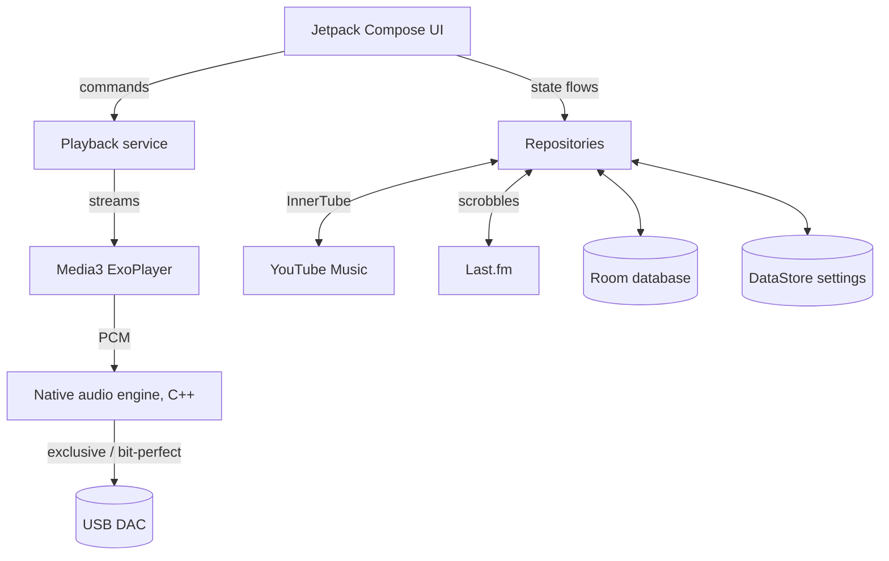
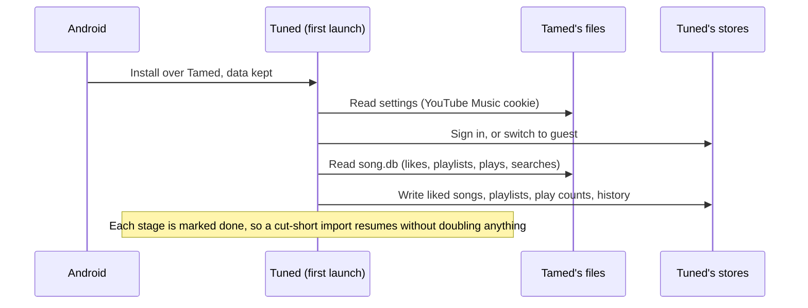

<p align="center">
  <picture>
    <source media="(prefers-color-scheme: dark)" srcset="docs/images/logo-dark.png">
    
  </picture>
</p>

Tuned is an Android music player for YouTube Music. It plays songs, albums, playlists and podcasts with synced lyrics, scrobbles to Last.fm, and sends audio bit-perfect to USB DACs. Installed over Tamed, it updates it in place and keeps the library.


## Features

- **YouTube Music playback**: songs, albums, artists, playlists and podcasts, in the background, with an optional sign-in that syncs your library, likes and history. Without an account it runs as a guest.
- **Synced lyrics**: word-by-word timing where the provider has it, from several providers you can switch between, with translation and romanisation for other scripts.
- **Lyric story cards**: share up to five lines as a 9:16 image coloured from the cover.
- **Bit-perfect output**: exclusive USB DAC output through a native audio engine, AutoEQ headphone correction, a 15-band equalizer and a signal path view that shows each stage the audio passes through.
- **Your library**: liked songs, your own playlists, songs stored on the phone, and mixes built from what you play. Public playlists import from Spotify, Apple Music and YouTube.
- **Downloads**: saved to a folder you choose, tagged with artwork and `.lrc` lyrics.
- **Last.fm**: scrobbling for Tuned and for other music apps on the phone.
- **Playback controls**: crossfade, speed and pitch, a sleep timer, Android Auto and Chromecast.
- **Widgets**: Full cover, Small, Medium and Wide, each coloured from the song's cover.
- **Updating from Tamed**: liked songs, playlists, listening history, searches and the YouTube Music sign-in carry over on first launch.


## System Architecture

Tuned is one Android app module plus a native USB audio driver module, split into three layers:



### 1. Interface (`ui/`)
* **Jetpack Compose**: every screen, with Material 3 components and Tuned's own type, colour and shape tokens in `ui/theme`.
* **Screens by feature**: `home`, `search`, `playlist`, `album`, `artist`, `player` (full player, lyrics, queue, share card), `settings`.
* **Widgets (`widget/`)**: RemoteViews drawn as bitmaps, since launchers can't load the app's fonts.

### 2. Playback (`playback/`, `cpp/`)
* **Media3 ExoPlayer** inside a media session service, so the notification, lock screen, Android Auto and Chromecast all drive the same player.
* **Native engine (`app/src/main/cpp`)**: PCM conversion, the equalizer, a lock-free ring buffer and direct output to the device, built with CMake.
* **USB driver (`audio/decent-usb-audio-driver`)**: talks to USB DACs directly for exclusive, bit-perfect output.

### 3. Data (`data/`)
* **Sources**: YouTube Music through InnerTube, Last.fm, and lyrics providers (`data/lyrics`).
* **Storage**: Room for playlists, play counts, downloads and caches; DataStore for settings. Names of saved data live in `data/StorageNames.kt` and stay fixed so updates never orphan what is on the phone.
* **Dependency injection**: Hilt.

### Updating from Tamed

Tuned ships with Tamed's app ID (`com.tamed.music`), a higher version code and the same signing key, so Android installs it over Tamed and keeps Tamed's files. On first launch `data/migration/TamedImporter` reads them once:




## Getting Started

### Prerequisites

- Android Studio with JDK 21
- Android SDK with platform 37 and the NDK
- Python 3 (the build generates native secrets with it)
- Git


### 1. Configure the SDK

Point Gradle at the SDK in `local.properties`:

```properties
sdk.dir=/path/to/Android/sdk
```


### 2. Build

```bash
./gradlew assembleDebug
```

The APK is written to `app/build/outputs/apk/debug/`.

#### Optional settings

These go in `.env` (see `.env.example`):

| Key | Description |
|---|---|
| `DISCORD_APPLICATION_ID` | Shows what you're playing on Discord. Off when empty. |
| `JAM_SERVER_URL` | Turns on Jam, listening together, against your own server. Hidden when empty. |
| `UPDATE_GITHUB_REPO` | `owner/repo` to check for new releases. Off when empty. |


### 3. Release builds

Release builds shrink the app with R8 and need a signing key in `local.properties`. To install over Tamed, use the key Tamed was signed with:

```properties
RELEASE_STORE_FILE=/path/to/keystore
RELEASE_STORE_PASSWORD=...
RELEASE_KEY_ALIAS=...
RELEASE_KEY_PASSWORD=...
```

```bash
./gradlew assembleRelease
```

*Keep that key safe. Without it, Tuned can't be installed over Tamed.*


## Requirements

Android 10 or newer. A Last.fm account and a YouTube Music sign-in are both optional.


## License

GPL-3.0. See [LICENSE](LICENSE).

Lossless, USB and bit-perfect playback come from LastWave by Duxtami and Ajisth, also GPL-3.0. Lyrics are set in Inter, under the SIL Open Font License 1.1.

Tuned is not affiliated with Google, YouTube, Last.fm, Spotify or Apple. It does not host or distribute media.
